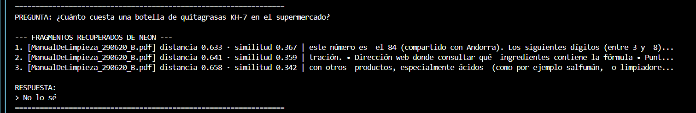
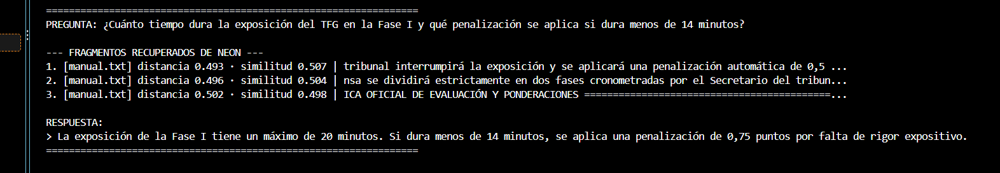
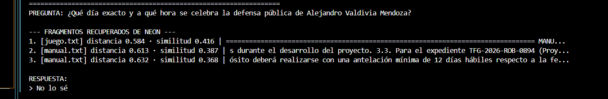

# Sistema RAG Mínimo con PGVector (Neon)

Sistema de **RAG** desarrollado en Python sobre **PostgreSQL + PGVector (Neon)**. Indexa una colección de documentos (`.pdf` y `.txt`) mediante embeddings multilingües locales y responde preguntas utilizando **únicamente** la información recuperada de dichos documentos, respondiendo `"No lo sé"` cuando el dato solicitado no aparece en ellos.

 Este proyecto reutiliza la infraestructura de conexión a Neon (`conexion.py`), el modelo local de embeddings (`paraphrase-multilingual-MiniLM-L12-v2`, 384 dimensiones) y la estructura de índices vectoriales `HNSW` desarrollados en la **Sesión 4 (PGVector)**, ampliándolos con un pipeline de *chunking* documental (`embeddings.py`) y generación aumentada (`rag.py`).


---

### Documentos
1. **`ManualDeLimpieza_290620_B.pdf`**
2. **`juego.txt`**
3. **`manual.txt`**

---

## Instalación y Ejecución

### 1. Crear entorno virtual e instalar dependencias
```bash
pip install -r requirements.txt
```

### 2. Configurar variables de entorno
Crea un archivo `.env` a partir de `.env.example` con tus credenciales.

### 3. Ejecutar el pipeline completo
```bash
python setup_db.py     
python embeddings.py   
python rag.py         
```

---

## Ejemplos de Pregunta-Respuesta (Entregable)

### Ejemplo 1: Pregunta respondible (información presente en los documentos)
* **Pregunta:**
  > *¿Cuál es el teléfono del Servicio Médico de Atención Toxicológica y qué hacer si salpica un producto en los ojos?*
* **Fragmento recuperado:** `ManualDeLimpieza_290620_B.pdf` (distancia `0.366` · similitud `0.634`)
* **Respuesta:**
  > El teléfono es el **91 562 04 20**. Si el producto salpica en los ojos, hay que **lavarlos inmediatamente con abundante agua** y acudir al oftalmólogo si fuera necesario, llevando si es posible la etiqueta o el envase del producto.


---

### Ejemplo 2: Pregunta NO respondible (información ausente en los documentos)
* **Pregunta:**
  > *¿Cuánto cuesta una botella de quitagrasas KH-7 en el supermercado?*
* **Fragmento recuperado:** `ManualDeLimpieza_290620_B.pdf` (distancia `0.633` · similitud `0.367`)
* **Respuesta:**
  > No lo sé



---

### Pruebas adicionales verificadas sobre los otros documentos

* **Documento 2 (`juego.txt` — Respondible):** *En Cronos-9, ¿cómo se determina el jugador inicial y qué recursos iniciales recibe cada jugador?* -> **Respuesta:** El jugador que haya reparado o cambiado la pila de un reloj más recientemente recibe la Llave Maestra de Cuerda y comienza la partida. Por orden de turno, los demás reciben: 2.º, 1 cubo de Latón; 3.º, 1 cubo de Acero Templado; 4.º, 1 cubo de Acero Templado y 1 Ficha de Éter Líquido.

  

* **Documento 2 (`juego.txt` — Sin datos):** *¿Cuál es el precio de venta al público del juego Cronos-9 y cuántas expansiones tiene?* -> **Respuesta:** `No lo sé`

  

* **Documento 3 (`manual.txt` — Respondible):** *¿Cuánto tiempo dura la exposición del TFG en la Fase I y qué penalización se aplica si dura menos de 14 minutos?* -> **Respuesta:** La exposición de la Fase I tiene un máximo de 20 minutos. Si dura menos de 14 minutos, se aplica una penalización de 0,75 puntos por falta de rigor expositivo.

  

* **Documento 3 (`manual.txt` — Sin datos):** *¿Qué día exacto y a qué hora se celebra la defensa pública de Alejandro Valdivia Mendoza?* -> **Respuesta:** `No lo sé`

  


### Estrategia de Troceado (*Chunking*) y Recuperación
* **Chunking con solapamiento:** Los documentos se dividen en fragmentos de **400 caracteres** con un **solapamiento (*overlap*) de 50 caracteres** (`embeddings.py`). Esto evita que frases o datos clave en los bordes de un corte pierdan su contexto semántico.
* **Recuperación Top-3:** Ante cada pregunta, `rag.py` recupera los 3 fragmentos con menor distancia coseno (`<=>`) en Neon y los inyecta íntegros en el contexto del modelo (en consola se muestra únicamente una vista previa de los primeros 85 caracteres de cada fragmento).
